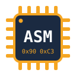

  
  
  <h1 align="center">
    
  </h1>

  🌐 [English](README.md) | [Español](README.es.md)

  <h3 align="center">Un apasionado Especialista en Ciberseguridad | Purple Team y DFIR</h3>
  
  
   

  - Soy especialista en **Ciberseguridad**
  
  - **[Echa un vistazo a mi portfolio de Ciberseguridad](https://github.com/martinmorente-dev/Cybersecurity/blob/main/README.md)**
  
  - Actualmente estoy aprendiendo en 42 Málaga: **[Mira mis proyectos de 42](https://github.com/martinmorente-dev/42/tree/main?tab=readme-ov-file)**
  
  - Cómo contactar conmigo: **martin.dev45@gmail.com**

 <h3 align="left">Lenguajes y herramientas:</h3> 
         

    
  ## Mi experiencia en 42
<strong>Mi experiencia en 42 sigue en marcha y ha sido uno de los viajes más transformadores que he vivido hasta ahora.</strong>  
En 42 me han empujado a pensar de otra manera, a aprender de forma independiente y a construir soluciones reales mediante un aprendizaje basado en proyectos, sin clases tradicionales ni profesores. Cada día es un reto que exige trabajo en equipo, adaptabilidad y mentalidad de crecimiento mientras trabajo bajo presión.

Desde sumergirme en la programación de bajo nivel en C y entender la gestión de memoria, hasta colaborar en proyectos que exigen código limpio y escalable, he ganado no solo habilidades técnicas, sino también la capacidad de aprender rápido y resolver problemas con eficacia.

Esta experiencia me está enseñando a manejar la ambigüedad, a escribir mejor código y a trabajar en entornos que simulan los retos del desarrollo en el mundo real. Estoy deseando seguir creciendo, superando mis límites y creando proyectos que reflejen la mentalidad que inspira 42: <strong>aprender haciendo, ayudar a los demás y no rendirse nunca.</strong>

### **[>> Ir a mis proyectos de 42 Málaga](https://github.com/martinmorente-dev/42/tree/main?tab=readme-ov-file)**

## Ciberseguridad
Explora mi camino en ciberseguridad, que reúne conocimientos fundamentales, proyectos prácticos y reflexiones a medida que avanzo en mi carrera Profesional de Ciberseguridad. Incluye casos de estudio, habilidades técnicas (SQL, PHP, bases de Linux) y conceptos de seguridad como la tríada CIA.

### **[>> Ir a mi portfolio de Ciberseguridad](https://github.com/martinmorente-dev/Cybersecurity/blob/main/README.md)**
  
  ## Proyectos realizados con frameworks y librerías
  
| Frameworks y proyectos | Lenguajes |
| ------------- | ----------------- |
| [Laravel](https://github.com/martinmorente-dev/Laravel) | PHP |
| [Django](https://github.com/martinmorente-dev/Django) | Python |
| [React](https://github.com/martinmorente-dev/React) | JS y TS |

  ## Proyectos grupales
  
| Nombre | Descripción |
| :---- | :--- |
| [Manage Courses](https://github.com/martinmorente-dev/Manage_Curses) | Una página de administración de formación que gestiona cursos, tareas, alumnos y profesores |
| [Events](https://github.com/CoralJG/DISENO_INTERFACES_EVENTOS) | Una página de tienda de juegos creada con HTML, CSS y JavaScript |
| [TFG DAM](https://github.com/martinmorente-dev/Sugarit#) | Una app móvil para personas con diabetes |
| [TFG DAW](https://github.com/martinmorente-dev/Infernum) | Una aplicación web para comprar juegos |
