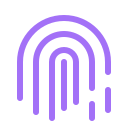

  
  
  <h1 align="center">
    
  </h1>
  
  
  
  <h3 align="center">A passionate Cyber Security Specialist | Purple Team & DFIR</h3>
  
  
   

  - I'm a **Cibersecurity** specialist
  
  - **[Check my Cybersecurity Portfolio](https://github.com/martinmorente-dev/Cybersecurity/blob/main/README.md)**
  
  - I’m currently learning on 42 Málaga: **[Check my 42 Projects](https://github.com/martinmorente-dev/42/tree/main?tab=readme-ov-file)**
  
  - How to reach me **martin.dev45@gmail.com**

 <h3 align="left">Languages and Tools:</h3> 
      <a href="https://www.python.org" target="_blank" rel="noreferrer">  

  

  

  
    
  ## My 42 experience 
<strong>My experience at  42 is still ongoing, it’s been one of the most transformative journeys I’ve had so far.</strong>  
At 42, I’ve been pushed to think differently, learn independently, and build real solutions through project-based learning without traditional classes or teachers. Every day is a challenge that requires teamwork, adaptability, and a growth mindset while working under pressure.

From diving deep into low-level programming in C and understanding memory management, to collaborating on projects that demand clean, scalable code, I’ve gained not just technical skills, but the ability to learn fast and solve problems effectively.

This experience is teaching me how to handle ambiguity, write better code, and work in environments that simulate real-world development challenges. I’m excited to continue growing, pushing my limits, and building projects that reflect the mindset 42 inspires: <strong>learning by doing, helping others, and never giving up.</strong>

### **[>> Go to my 42 Málaga Projects](https://github.com/martinmorente-dev/42/tree/main?tab=readme-ov-file)**

## Cybersecurity
Explore my ongoing journey in cybersecurity, showcasing foundational knowledge, hands-on projects, and reflections as I progress through the Google Cybersecurity Professional Certificate. Includes case studies, technical skills (SQL, PHP, Linux basics), and insights into security principles like the CIA Triad.

### **[>> Go to my Cybersecurity Portfolio](https://github.com/martinmorente-dev/Cybersecurity/blob/main/README.md)**
  
  ## Realized Proyects by Frameworks & Libraries
  
| Frameworks & Projects     | Languages         |
| ------------- | ----------------- |
| [Laravel](https://github.com/martinmorente-dev/Laravel) | PHP             |
| [Django](https://github.com/martinmorente-dev/Django)    | Python           |
| [React](https://github.com/martinmorente-dev/React)   | Js & Ts          |

  ## Groupal proyects
  
| Name       | Description    | 
| :----            | :---|
| [Manage Courses](https://github.com/martinmorente-dev/Manage_Curses) | An administration learning page that manages courses, homework, students, and professors |
|[Events](https://github.com/CoralJG/DISENO_INTERFACES_EVENTOS) | A game page store build on html css javascript
| [TFG DAM](https://github.com/martinmorente-dev/Sugarit#) | Kotlin |
| [TFG DAW](https://github.com/martinmorente-dev/Infernum) | Laravel, Angular, AWS|

